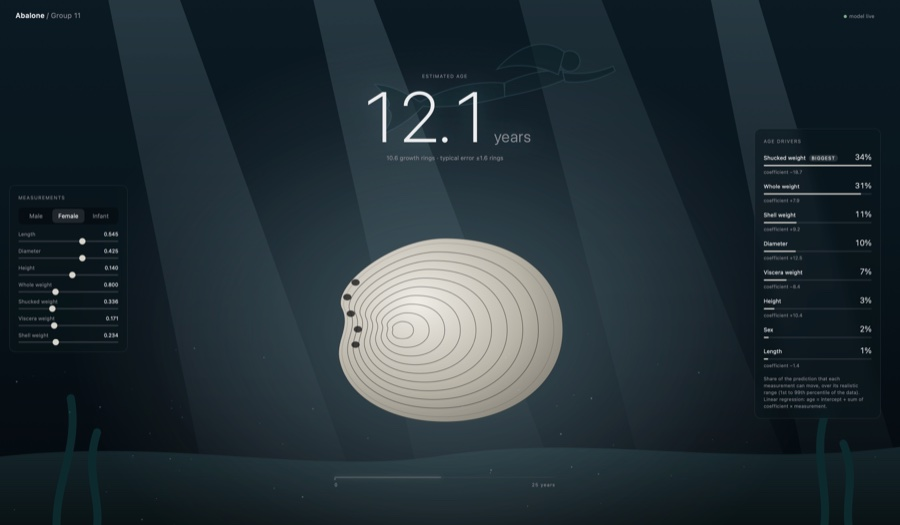

# MLOps Project: Abalone Age Prediction

<a href="https://louanbardou.github.io/xhec-mlops-2026-project/"></a>

**Live demo: https://louanbardou.github.io/xhec-mlops-2026-project/** (move the sliders, the abalone grows and the age updates; the "Age drivers" panel shows what counts in the model). See [Dashboard](#dashboard).

Goal: predict the age (number of rings) of an abalone from its physical measurements, so nobody has to count rings under a microscope. The model is trained with Prefect and served with a FastAPI API in Docker.

Dataset: [Kaggle abalone dataset](https://www.kaggle.com/datasets/rodolfomendes/abalone-dataset)

## Team

| Name | GitHub |
|---|---|
| Lancelot Brisset | brissetlancelot92 |
| Louan Bardou | louanbardou |
| Alix Bernal | ALX-7777 |
| Blanche Mahe | blanchemahe |

## Setup

You need [uv](https://docs.astral.sh/uv/) (it installs Python 3.11 for you) and make.

```bash
make install   # installs the dependencies and the pre-commit hooks
make lint      # formats and checks the code with ruff
```

## Train the model

The dataset is already in `data/abalone.csv` (UCI version, same data as Kaggle), so no Kaggle account needed.

```bash
make train   # trains the model and saves it in src/web_service/local_objects/model.pkl
uv run pytest   # runs the tests
```

The code is in `src/modelling/`: `step1_preprocessing.py` (load + split), `step2_training.py` (model + metrics), `step2_1_utils.py` (save and load the model), `step3_predicting.py` (predict with the saved model), `main.py` (runs everything).
The model is a linear regression, with `Sex` one-hot encoded inside a sklearn pipeline (see `notebooks/` for the EDA and why we chose it).

## Prefect (automatic retraining)

`main.py` is a Prefect flow (one task per step). `make train` runs it once. To retrain every Monday at 3am, use 2 terminals:

```bash
make prefect-server   # terminal 1: starts the prefect server, UI on http://127.0.0.1:4200
make deploy           # terminal 2: creates the "weekly-retraining" deployment (keep it running)
```

Open http://127.0.0.1:4200 to see the deployment and the flow runs. To test without waiting for Monday, click "Run" on the deployment in the UI, or in a 3rd terminal:
`uv run prefect deployment run 'train-abalone-model/weekly-retraining'`

## API (FastAPI + Docker)

The API predicts the rings (and the age = rings + 1.5) of one abalone. The inputs are validated with Pydantic (`sex` must be M, F or I, all the measurements must be > 0).

Without Docker (needs `make train` first):

```bash
make api   # http://127.0.0.1:8001/docs
```

With Docker (the image trains the model when it is built, and runs the API + the prefect server):

```bash
make docker-build
make docker-run   # API on http://localhost:8000, prefect UI on http://localhost:4200
```

Try it:

```bash
curl -X POST http://localhost:8000/predict -H "Content-Type: application/json" \
  -d '{"sex": "M", "length": 0.455, "diameter": 0.365, "height": 0.095, "whole_weight": 0.514, "shucked_weight": 0.2245, "viscera_weight": 0.101, "shell_weight": 0.15}'
# {"rings": 9.22, "age": 10.72}
```

(When using `make api` instead of Docker, the port is 8001.)

## Dashboard

One web page served by the API (no extra dependency, no build): a single ocean scene.

- **Left**: sliders for the measurements. The 3 partial weights can never exceed the whole weight.
- **Center**: the abalone grows ring by ring up to its predicted age when the page opens, then follows the sliders smoothly (size, number of rings, age). The model is a linear regression, so the page computes the estimate from the coefficients of `/model` (no delay) and the API confirms it through `/predict`.
- **Right**: "Age drivers", the share of each measurement in the linear regression (coefficient × realistic range of the measurement, in %), biggest first.

```bash
make api   # needs make train first, then open http://127.0.0.1:8001/dashboard
```

With Docker: http://localhost:8000/dashboard. `make static` builds `docs/index.html`, a copy that needs no server (model and metrics are embedded). It is served by GitHub Pages: https://louanbardou.github.io/xhec-mlops-2026-project/ The typical error shown under the age comes from `src/web_service/local_objects/metrics.jsonl` (one line added at each training).

## Project structure

```
data/abalone.csv        dataset
notebooks/              EDA and first model
src/modelling/          training code (prefect flow, deployment)
src/web_service/        FastAPI app + dashboard (static/index.html)
tests/                  pytest
bin/run_services.sh     starts the prefect server and the API in the container
Dockerfile.app          Docker image
Makefile                shortcuts for everything above
```

## ⚠️ Other Instructions

- **GitHub IDs**: Every student must make at least one significant commit that is merged into the main branch. Changing a variable value or adding a space is not significant. Don't fail the module over a mistake like this.
- **No squashing**: Do not squash your commits when you merge a branch. Your commit history is used to track your progress.
- **No blind coding or overengineering**: Stay in control of your code and understand all of it. This is evaluated specifically, so keep your code straight to the point and objective-oriented.
- **Clear setup instructions**: Keep them simple. Evaluators won't spend hours trying to start your project (but they'll try harder than [this dad](https://www.youtube.com/watch?v=H_ecbkcYH94)). A Makefile would be appreciated.
- **Main branch only**: Only the work on the `main` branch is evaluated. Any work left on other branches is not considered.
